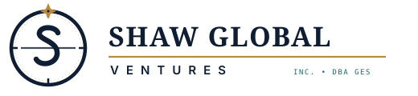

<div align="center">

  

  # SHAW GLOBAL VENTURES INC.
  ### Government Contracting • Digital Outreach • Essential Supply Solutions
  **Operating DBA: GES Social Media Management**

  <p align="center">
    <em>“True north for public service.”</em>
  </p>

  <p align="center">
    <a href="https://sam.gov"></a>
    
    
    
  </p>

  <p align="center">
    <a href="#-executive-summary">Executive Summary</a> •
    <a href="#-federal-contractor-profile">Federal Profile</a> •
    <a href="#-core-capabilities">Core Capabilities</a> •
    <a href="#-mission-vision--values">Mission & Values</a> •
    <a href="#-project-structure">Architecture</a> •
    <a href="#-quick-start">Quick Start</a>
  </p>

</div>

---

## 🏛 Executive Summary

**Shaw Global Ventures Inc. (SGV)**, operating as **GES Social Media Management**, is a veteran-led business delivering high-reliability digital communications, public outreach campaigns, and institutional supply solutions to federal, state, and municipal agencies, prime contractors, and commercial organizations.

As a veteran-led enterprise, SGV is anchored in **mission discipline**, **transparent reporting**, and **dependable fulfillment**. We operate across two complementary capability vectors:
1. **Public Sector Digital Engagement:** Full-lifecycle social media management, crisis communications moderation, public awareness campaigns, and Section 508 accessibility-compliant multimedia content.
2. **Essential Institutional Supply Chain:** Scheduled batch replenishment and rapid fulfillment of medical-grade personal protective equipment (PPE) and commercial facility sanitization goods.

---

## 📋 Federal Contractor Profile

| Corporate Attribute | Official Specification |
| :--- | :--- |
| **Legal Business Name** | **Shaw Global Ventures Inc.** |
| **Doing Business As (DBA)** | **GES Social Media Management** |
| **Unique Entity ID (UEI)** | `[YOUR UEI]` |
| **CAGE Code** | `[YOUR CAGE]` |
| **SAM.gov Status** | Active • Verified Federal Vendor |
| **Socio-Economic Status** | Veteran-Led Small Business Enterprise |
| **Contract Roles** | Prime Contractor & Subcontracting / Teaming Partner |
| **Quality & Compliance Baselines** | Federal Acquisition Regulation (FAR) Flow-Downs • Section 508 Accessibility |

### Primary NAICS Codes Matrix

```
┌───────────┬─────────────────────────────────────────────────────────────┬───────────────────────────┐
│ NAICS     │ Formal Industry Description                                 │ SGV Operational Focus     │
├───────────┼─────────────────────────────────────────────────────────────┼───────────────────────────┤
│ 541820 ★  │ Public Relations Agencies (PRIMARY)                         │ Digital Outreach & Media  │
│ 541810    │ Advertising Agencies                                        │ Civic Awareness Campaigns │
│ 541830    │ Media Buying Agencies                                       │ Targeted Public Placement │
│ 423450    │ Medical, Dental, and Hospital Equipment & Supplies Wholesalers│ PPE & Healthcare Supplies │
│ 423850    │ Service Establishment Equipment and Supplies Wholesalers    │ Janitorial Sanitation     │
│ 561720    │ Janitorial Services Support                                 │ Facility Hygiene Systems  │
└───────────┴─────────────────────────────────────────────────────────────┴───────────────────────────┘
★ Primary Designated NAICS Code
```

### Federal Supply Classification (FSC / PSC)
* **PSC 6515:** Medical and Surgical Instruments, Equipment, and Supplies

---

## 🎯 Core Capabilities (The 4 Pillars)

### 1. Government-Focused Social Media Management & Digital Outreach
* **Agency-Compliant Scheduling & Publishing:** Disciplined multi-channel content rollout aligned with federal transparency protocols and records retention guidelines.
* **Public Inquiries & Crisis Communications:** Continuous community engagement monitoring with predefined rapid escalation protocols for emergency announcements.
* **Section 508 Accessible Production:** Closed-captioned video production, descriptive alt text, high-contrast visual formatting, and screen-reader compliant collateral.
* **Constituent Sentiment & Performance Analytics:** Transparent data reporting tracking message velocity, audience reach, and demographic engagement.

### 2. Marketing, Advertising, and Public Relations Support
* **Demographic-Targeted Digital Campaigns:** Paid and organic placement across search, social, and digital display networks to reach specific community demographics.
* **Civic Education & Recruitment Rollouts:** Purpose-built campaigns designed to educate, inform, and mobilize citizen groups and prospective public service recruits.
* **Press Releases & Media Relations:** Executive drafting, distribution to accredited media outlets, and stakeholder communication briefs.

### 3. Medical and Personal Protective Equipment (PPE) Supplies
* **Certified Diagnostic & Barrier Gear:** Nitrile, latex, and vinyl examination gloves (medical grade), surgical masks, N95/KN95 respirators, and protective face shields.
* **Isolation & Cleanroom Apparel:** Fluid-resistant isolation gowns, coveralls, shoe covers, and protective cleanroom apparel.
* **Vetted Supply Chain:** Direct relationships with vetted domestic distributors guaranteeing lot traceability, batch integrity, and rapid delivery schedules.

### 4. Janitorial and Facility Supply Solutions
* **Commercial Sanitization & Disinfectants:** EPA-registered disinfectants, virucides, and multi-surface antibacterial agents for municipal and correctional facilities.
* **High-Volume Custodial Paper & Dispensers:** Institutional towel rolls, toilet tissue, multi-fold paper goods, heavy-duty can liners, and touchless dispensing systems.
* **Environmentally Preferable Solutions:** Green Seal® compliant detergents and cleaning chemicals formulated for sensitive public spaces and educational facilities.

---

## 🧭 Mission, Vision & Core Values

```
                              ┌───────────────────────────────────┐
                              │     OUR MISSION                   │
                              │     Responsive, practical, and    │
                              │     dependable solutions that     │
                              │     help agencies achieve their   │
                              │     operational objectives.       │
                              └─────────────────┬─────────────────┘
                                                │
                                                ▼
                              ┌───────────────────────────────────┐
                              │     OUR VISION                    │
                              │     To build lasting partnerships │
                              │     as a trusted provider of      │
                              │     digital outreach services     │
                              │     and essential supply chains.  │
                              └─────────────────┬─────────────────┘
                                                │
         ┌───────────────────┬──────────────────┼───────────────────┬───────────────────┐
         ▼                   ▼                  ▼                   ▼                   ▼
  [ ACCOUNTABILITY ]  [ RELIABILITY ]    [ INTEGRITY ]      [ ADAPTABILITY ]    [ PARTNERSHIP ]
   Taking ownership    Maintaining clear   Conducting all     Tailoring each      Building long-
   of deliverables     communication &     business with      solution to agency  term teaming
   and milestones.     responsiveness.     transparency.      specifications.     alliances.
```

---

## 📁 Repository Architecture & Folder Structure

The project follows a clean, modular, and dependency-free web architecture:

```
SHAW_GLOBAL_VENTURES_INC/
│
├── assets/                       # Vector Branding & Icons
│   ├── icon.svg                  # Brand Compass Favicon & Watermark
│   ├── logo.svg                  # Master Primary Northbound Logo
│   └── logo-white.svg            # Contrast Inverted Logo for Dark Backdrops
│
├── components/                   # Reusable Partial Component Templates
│   ├── capability-modal.html     # Federal Capability Statement Modal
│   ├── footer.html               # 4-Column Enterprise Footer & DBA Ribbon
│   ├── header.html               # Master Fixed Header & Federal Command Bar
│   └── sidebar.html              # Mobile Navigation Drawer & Credentials Card
│
├── css/                          # Design System & Responsive Stylesheets
│   └── styles.css                # "Northbound" Direction 01 Theme & Tokens
│
├── images/                       # Verified Commercial Product Photography
│   ├── janitorial.jpg            # Industrial Custodial & Sanitation Inventory
│   └── medical and ppe.webp      # 3M N95, Sterile Gowns, Gloves & PPE Equipment
│
├── js/                           # Interactive UI Logic & State Engine
│   ├── app.js                    # Mobile Drawer, 1-Click Code Copy, & Modal Engine
│   └── components.js             # Reusable Web Component Engine
│
├── .gitignore                    # Version Control Ignores
├── about.html                    # "About Us", Mission, & Values Page
├── index.html                    # Root Homepage & Executive Procurement Landing
└── README.md                     # Enterprise Documentation
```

---

## 🎨 Design System: "Northbound" (Direction 01)

The website is engineered to exude **federal authority, timeless precision, and civic trust**:

| Token Name | Hex Code | Visual Application |
| :--- | :--- | :--- |
| **Midnight Navy** | `#0F1E33` | Primary structural background, command bars, hero contrast |
| **Meridian Brass** | `#B98A3E` | Strategic action highlights, primary badges, and key accents |
| **Harbor Teal** | `#1E6B66` | Analytical metrics, compliance pills, and interactive hover states |
| **Parchment Neutral** | `#EDE6D6` | Subtle matrix borders, metadata containers, and section dividers |
| **Field Ivory** | `#F7F3EA` | Clean, high-legibility document canvas and content surfaces |

### Typography Stack
* **Headlines & Editorial Titles:** `Source Serif 4` (Executive Serif, authoritative, legible)
* **Body & UI Elements:** `IBM Plex Sans` (Humanist precision, high readability across mobile and desktop)
* **Federal Identifiers & Codes:** `IBM Plex Mono` (Clean tabular monospace for UEI, CAGE, and NAICS codes)

---

## ⚡ Technical Features

* **Zero Build Dependencies:** Written in semantic modern HTML5, vanilla CSS3, and ES6 JavaScript. No bundlers or Node runtimes required for deployment.
* **Condensed Straight-Line Navigation:** Optimized desktop navbar that remains streamlined without text wrapping or awkward breaks.
* **Accessible Mobile Navigation Drawer:** Single-hand mobile drawer with smooth backdrop transitions and mobile-optimized federal credentials card.
* **Instant Code Copy:** One-click clipboard copy utility for federal contracting officers looking up UEI, CAGE, and NAICS numbers.
* **Interactive Capability Statement Modal:** Complete printable federal dossier with custom `@media print` rules, allowing one-click PDF generation directly from the browser.
* **Interactive RFP Intake Engine:** Real-time form input linking service scope selection to automated submission workflows.
* **Section 508 & WCAG AAA Contrast:** All text pairings exceed standard accessibility contrast ratios (including semi-transparent backdrops with directional overlays).

---

## 🚀 Quick Start & Local Preview

Clone the repository and serve with any local HTTP server:

```bash
# 1. Clone the repository
git clone https://github.com/rhamifydev/Shaw-Global-Ventures-Inc..git

# 2. Enter project directory
cd Shaw-Global-Ventures-Inc.

# 3. Start a local preview server
# Using Python 3:
python -m http.server 3000

# Or using Node:
npx serve .
```

Open your browser and navigate to:
* **Home Page:** `http://localhost:3000/` or `http://localhost:3000/index.html`
* **About Us Page:** `http://localhost:3000/about.html`

---

## 🤝 Teaming & Procurement Inquiries

Shaw Global Ventures Inc. actively teams with large prime contractors seeking reliable, high-performing, veteran-led partners to meet statutory small business participation goals.

* **Procurement Desk:** `contracts@shawglobalventures.com`
* **Operating DBA:** GES Social Media Management
* **Entity Registration:** Active on [SAM.gov](https://sam.gov)

---

<div align="center">
  <sub>© 2026 Shaw Global Ventures Inc. All rights reserved. • Built with precision under Direction 01: Northbound.</sub>
</div>
